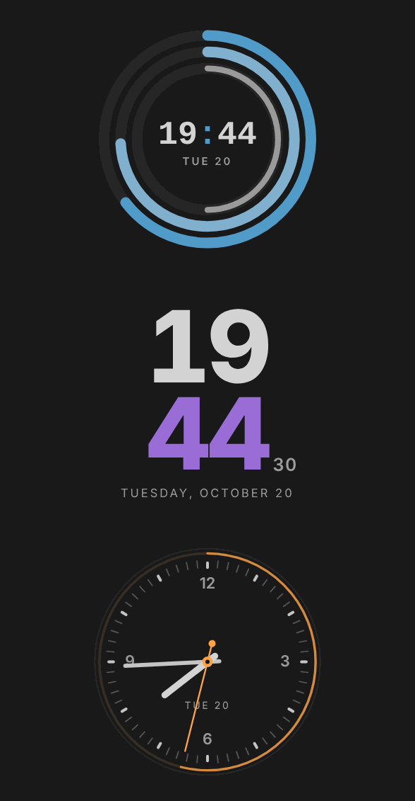
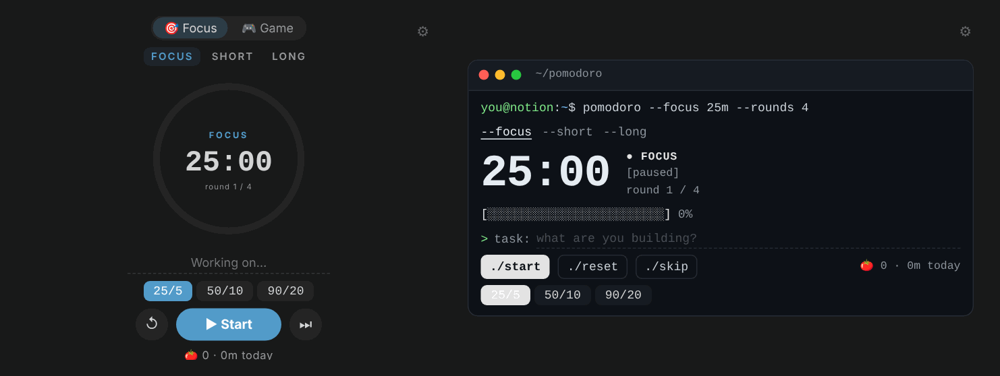
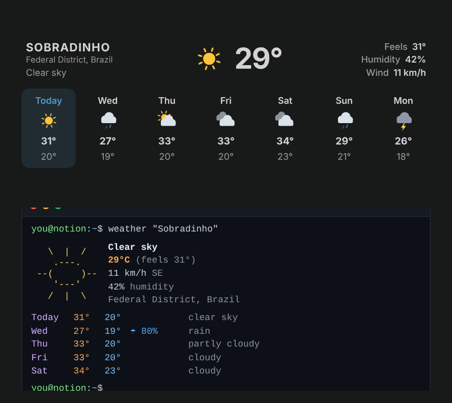
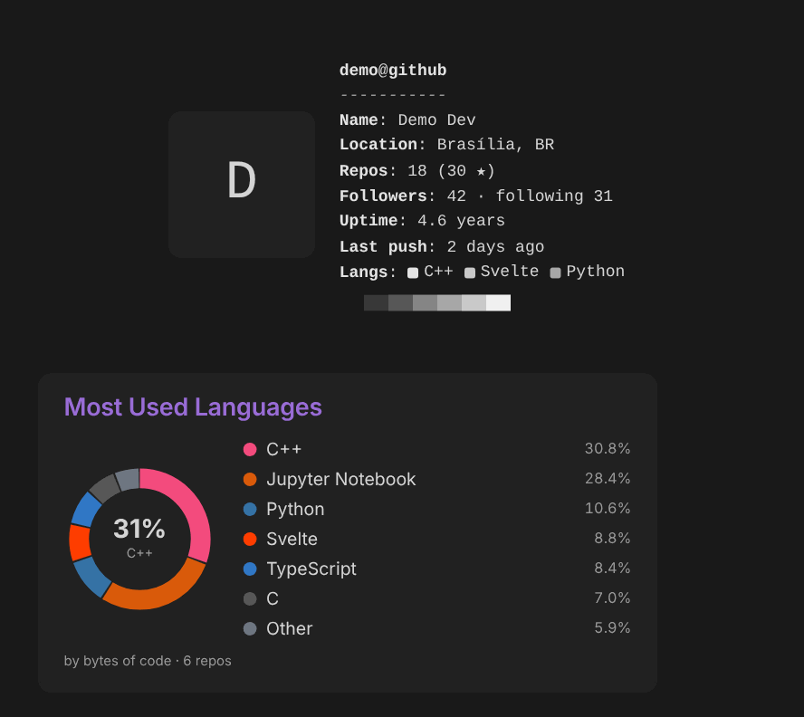
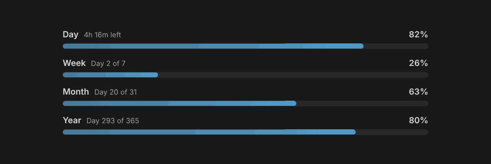
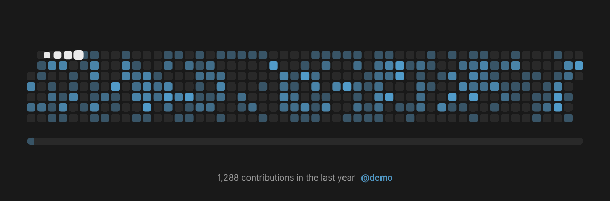
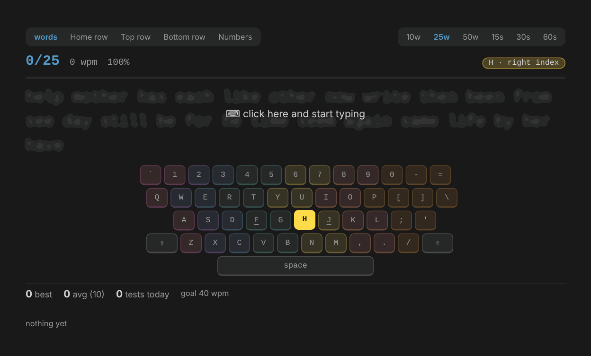
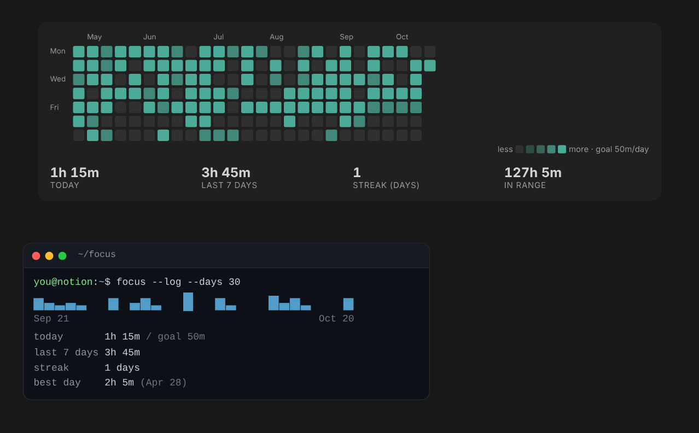
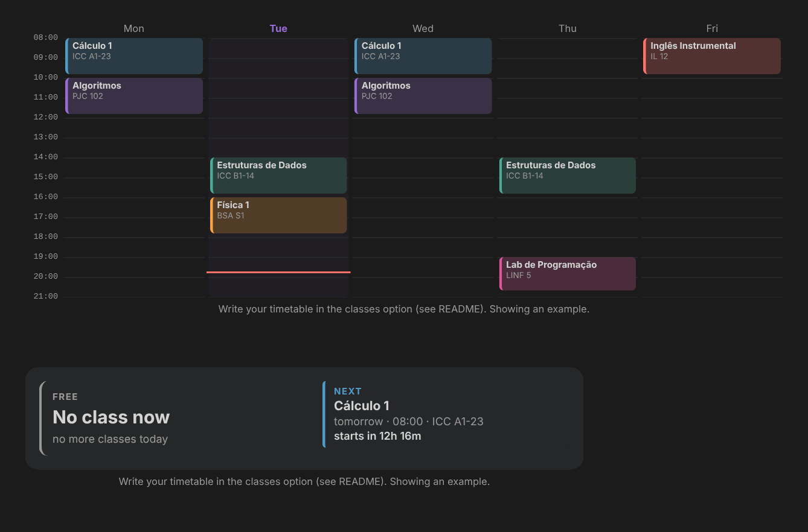

# Notion Widgets

**Free, embeddable widgets for Notion, Obsidian and any app that can show a web page.**
Clocks, a Pomodoro timer, weather, progress bars, a GitHub contribution snake, a typing trainer and more. No account, no API keys, no install: pick a widget, tweak it, copy the link, embed it.

### ▶ [Open the Workbench: the-jonas.github.io/Notion_Widgets](https://the-jonas.github.io/Notion_Widgets/)

The Workbench lets you try every widget live, change its options and copy the ready-to-embed link.

---

## Gallery

| | |
|---|---|
| **🕐 Clock**: seven faces (orbit rings, dots, stacked type, analog, hybrid, digital, minimal). | **⏱ Pomodoro + Game timer**: focus cycles, presets, daily stats and a countdown for game time. Seven styles. |
|  |  |
| **🌤 Weather**: current weather and the next days for any city, with an hourly panel per day. Ten layouts. | **🐙 GitHub**: profile card or neofetch, repository cards, commit streak stats and most used languages. |
|  |  |
| **📊 Progress**: how much of the day, week, month and year (or any custom range) has passed. Eleven styles. | **🐍 GitHub Snake**: your contribution graph being eaten by a snake, in order, with a progress bar. |
|  |  |
| **⌨️ Typing Trainer**: learn to type with 10 fingers. Row lessons, real words (EN/PT), an on-screen keyboard showing which finger to use, WPM history and the keys you miss most. | **🍅 Focus Map**: your Pomodoro minutes per day as a GitHub-style grid, bars or a terminal sparkline, with streak and totals. |
|  |  |
| **🎓 Classes Now/Next**: write your weekly timetable once and see what is on now, how long it lasts and what comes next, or the whole week. | |
|  | |

Every widget has a dark and a light theme, Notion's accent colors (plus `mono`: black, white and gray) and a transparent background that blends with the page.

---

## How to use

1. Open the **[Workbench](https://the-jonas.github.io/Notion_Widgets/)** and pick a widget.
2. Change the options until you like it, then click **Copy embed URL**.
3. Paste the link in your app:

| Where | How |
|---|---|
| **Notion** | Type `/embed`, paste the link and resize the block. |
| **Obsidian** | In a note, add `<iframe src="PASTE-THE-LINK" width="100%" height="240" style="border:0"></iframe>`. It shows in Reading view and Live Preview. The [Custom Frames](https://github.com/Ellpeck/ObsidianCustomFrames) plugin also works, if you want a widget in the sidebar. |
| **Anything else** | Any app or website that can embed a web page (an iframe) works: wikis, dashboards, a browser start page, your personal site, an OBS *Browser source*... |

Changed your mind later? Hover the widget and click **✎** (bottom-right) to edit it in place. See [Edit an embed later](#edit-an-embed-later).

### Your data stays with you
There is no server and no account. Settings and stats (timer state, focus history, typing scores) are saved in **your browser**, on the device where you use them. The only network calls go to free public APIs: [Open-Meteo](https://open-meteo.com) for weather and the GitHub API for the GitHub widgets.

---

## Widgets and options

Options are plain URL parameters, so you can also edit a link by hand. The Workbench lists all of them with their defaults.

| Widget | Path | Options |
|---|---|---|
| Clock | `widgets/clock/` | `style` (orbit/dots/minimal/stack/analog/hybrid/digital), `format` (24/12), `seconds`, `sweep`, `numerals`, `digits`, `date`, `lang` |
| Timer | `widgets/timer/` | `style` (ring/orbit/pill/card/retro/minimal/terminal), `gamemode` (0 hides the Game mode), `id` (embeds with the same `id` share one timer: start it in one page, see it running in all of them), `mode`, `focus`, `short`, `long`, `rounds`, `game`, `sound`, `tick`, `auto`, `label_*` |
| Progress | `widgets/progress/` | `style` (bars/glow/outline/blocks/dots/retro/rings/concentric/columns/cards/text), `title`, `day`, `week`, `month`, `year`, `detail`, `colors` (single/multi), `decimals`, `weekstart`, `lang`, `start` + `end` (custom range), `label_*` |
| GitHub Snake | `widgets/snake/` | `user` (GitHub username, or `demo`), `style` (classic/smooth/neon/pixel), `dots` (accent/github), `snake_color` (auto or a Notion color), `snake_hex` (any color, e.g. `ff6b9d`), `speed`, `bar` (smooth/steps/none), `bar_shape` (auto/rounded/square/segments/dots/line/levels), `stats`, `lang`, `source` (live = animated in the browser; generated = SVG built daily on deploy by `scripts/snake-outputs.mjs`) |
| Weather | `widgets/weather/` | `city` (`Paris`, `Sobradinho, DF`... or `demo`), `label`, `region`, `style` (classic/hero/glass/bento/chart/sun/list/minimal/strip/terminal), `units` (c/f), `days` (3/5/7), `details`, `animate`, `link` (panel/google/windy/none), `lang`, `lat` + `lon`. Cached for 30 min. |
| GitHub | `widgets/github/` | `user` (or `demo`), `mode` (profile/repos/stats/langs), `style` (card/neofetch), `repo` (owner/name), `count` (number or `all`), `forks`, `sort` (updated/stars), `lang`. Languages (`mode=langs`): `layout` (compact/donut/bars/terminal/pie/chips), `top`, `hide` (e.g. `Jupyter Notebook,HTML`), `by` (bytes/repos), `sample`, `title` (`-` hides). Click a repo card for languages, last commits and `git clone`. No token needed, cached for 1 hour. |
| Typing Trainer | `widgets/typing/` | `mode` (words/home/top/bottom/numbers), `limit` (10w/25w/50w/15s/30s/60s), `words` (en/pt/mix), `accents`, `layout` (qwerty/abnt2), `keyboard`, `goal` (WPM), `style` (clean/terminal), `lang`. Tab or Esc restarts. |
| Focus Map | `widgets/focus/` | `style` (grid/bars/terminal), `weeks` (grid), `days` (bars), `goal` (minutes per day), `stats`, `demo`, `lang`. Reads the minutes saved by the Timer widget on the same device. |
| Classes | `widgets/classes/` | `classes` (your timetable, see below), `style` (card/week/terminal/minimal), `room`, `lang` |

Every widget also accepts `theme` (dark/light), `accent` (blue/purple/green/orange/red/pink/yellow/gray/mono), `bg` (transparent/card/page) and `edit` (0 hides the ✎ editor).

**Timetable format** for the Classes widget, one class per item, separated by `;`:

```
mon,wed 08:00-09:50 Calculus 1 @ Room A1-23; tue 14:00-15:50 Physics @ Lab 2
```

Days: `mon tue wed thu fri sat sun` (or `seg ter qua qui sex sab dom`). The room after `@` is optional.

---

## Edit an embed later
- **Inside the app:** hover a widget and click **✎** (bottom-right). Change anything and **Save**: it applies right away to that embed on this device. **Copy URL** gives the new link; replace the embed's link to make the change permanent on every device. **Reset to embed** drops the local changes.
- **In the Workbench:** paste an existing embed link in the box at the top and click **Load** to keep editing it.

---

## For developers

Built with [Svelte 5](https://svelte.dev) + [Vite](https://vite.dev) + TypeScript. Every widget is a small standalone page, so it loads fast inside an iframe.

```bash
npm install      # first time only
npm run dev      # Workbench at http://localhost:5173
npm run build    # static site in dist/
```

**Add a widget**
1. Create `widgets/<id>/index.html` pointing to `src/widgets/<id>/main.ts`.
2. Create the Svelte component in `src/widgets/<id>/` and call `mountEditor('<id>')` in `main.ts`.
3. Register it in `src/shared/registry.ts` so the Workbench shows it.

**Host your own copy**: fork the repo, change `base` in `vite.config.ts` to `/<your-repo-name>/` and `PUBLIC_BASE` in `src/shared/registry.ts`, then enable GitHub Pages with GitHub Actions. Every push to `main` builds and publishes the site.

Ideas, bugs and new widgets are welcome. Open an issue or a pull request.
